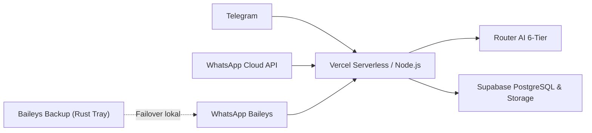

# FreeAIBot

Asisten AI multimodal untuk Telegram dan WhatsApp (Cloud API serta Baileys) yang dibangun dengan TypeScript, Vercel Serverless, dan Supabase PostgreSQL. Repositori ini juga mencakup utilitas desktop Rust bernama **Baileys Backup** untuk menjaga bot WhatsApp tetap siaga lewat failover lokal di Windows.

[](LICENSE)
[](https://www.typescriptlang.org/)
[](https://nodejs.org/)
[](tools/wa-standby-watchdog)
[](https://free-chatbot-ai.vercel.app)
[](https://supabase.com)
[](https://t.me/chatkita_bot)
[](https://wa.me/6283874640066)

### Akses Layanan

| Layanan | Tautan / Kontak | Keterangan |
| :--- | :--- | :--- |
| **Telegram Bot** | [@chatkita_bot](https://t.me/chatkita_bot) | Webhook Vercel Serverless, mendukung obrolan pribadi dan grup |
| **WhatsApp Bot** | [+62 838-7464-0066](https://wa.me/6283874640066) | WhatsApp Cloud API dan Baileys (lihat [Mode Pemeliharaan WhatsApp](#mode-pemeliharaan-whatsapp)) |
| **Web & Dashboard** | [free-chatbot-ai.vercel.app](https://free-chatbot-ai.vercel.app) | Beranda informasi, status layanan, dan konsol monitoring |

---

## Fitur Utama

- **Pemrosesan Multimodal**: Membaca gambar, foto, stiker, pesan suara (transkripsi Whisper), serta dokumen kerja (PDF, `.doc`/`.docx`, `.xls`/`.xlsx`, `.pptx`, TXT, CSV).
- **Pencarian Web**: Mengambil referensi berita dan artikel terkini dari beberapa sumber publik tanpa kunci API berbayar.
- **Produktivitas & Pengingat**: Catatan pribadi, daftar tugas, pencatatan pemasukan dan pengeluaran, daftar belanja, ringkasan berkala, serta pengingat satu kali, berulang, maupun multi-hari melalui perintah `/` atau bahasa alami.
- **Dukungan Grup Terisolasi**: Berjalan di grup Telegram dan WhatsApp Baileys dengan tiga mode (`/mention`, `/nimbrung`, `/diam`) serta pemisahan tabel database grup dari chat pribadi.
- **Memori, Zona Waktu & Permainan**: Menyimpan riwayat percakapan, preferensi pengguna, dan zona waktu per pengguna (WIB, WITA, WIT, serta internasional) di Supabase PostgreSQL, ditambah mesin permainan interaktif berbasis state database.
- **Failover AI Multi-Tier**: Merutekan permintaan teks dan vision secara otomatis melalui enam tier provider (OpenCode, Cloudflare Workers AI, Groq, DreamPrompting, OpenRouter, Gemini) dengan pelacakan kuota harian, cooldown persisten, dan rotasi kunci. Konfigurasi model aktif dikelola terpusat di [`src/env.ts`](src/env.ts).
- **Baileys Backup (Failover Lokal Windows)**: Aplikasi desktop native Rust (`BaileysBackup.exe`) di Windows System Tray tanpa jendela terminal yang memantau VPS Baileys secara berkala, menyalakan bot lokal otomatis saat VPS berhenti atau tertidur, menyediakan panel statistik native, dan menyinkronkan sesi ke Supabase.

---

## Arsitektur & Teknologi



| Komponen | Teknologi |
| :--- | :--- |
| **Runtime** | TypeScript 5.6, Node.js 22.x (ESM) |
| **Deployment** | Vercel Serverless Functions |
| **Transport Pesan** | `node-telegram-bot-api`, Meta WhatsApp Cloud API, `@whiskeysockets/baileys` |
| **Basis Data & Storage** | Supabase PostgreSQL dengan Row Level Security (RLS) dan Supabase Storage |
| **Standby Watchdog** | Rust dan Win32 API di [`tools/wa-standby-watchdog`](tools/wa-standby-watchdog) |

---

## Perintah Bot

Daftar perintah resmi yang aktif di aplikasi:

| Perintah | Fungsi |
| :--- | :--- |
| `/start` | Memulai percakapan dan menyapa bot |
| `/help` | Menampilkan daftar lengkap fitur dan perintah |
| `/tanya <pertanyaan>` | Mengajukan pertanyaan langsung ke AI |
| `/reset` | Memulai sesi baru dan menghapus riwayat percakapan |
| `/salah <koreksi>` | Menyimpan koreksi atau preferensi personal pengguna |
| `/catat <isi>` | Menyimpan catatan bebas atau jurnal |
| `/catatan` | Menampilkan catatan terakhir |
| `/cari <kata>` | Mencari catatan tersimpan berdasarkan kata kunci |
| `/tugas <isi>` | Menambahkan tugas baru ke daftar |
| `/list` | Menampilkan daftar tugas yang ada |
| `/barang` | Mencatat atau melihat daftar barang dan belanja |
| `/uang <nominal> <keterangan>` | Mencatat pengeluaran harian |
| `/masuk <nominal> <keterangan>` | Mencatat pemasukan |
| `/rekap [hari]` | Menampilkan rekap keuangan berdasarkan rentang hari |
| `/hapusuang <nomor>` | Menghapus entri catatan keuangan berdasarkan nomor urut |
| `/ringkasan` | Menampilkan ringkasan keuangan, tugas, pengingat, dan catatan |
| `/remind <menit> <pesan>` | Menjadwalkan pengingat otomatis |
| `/mention` | Mengatur mode grup agar bot hanya membalas saat ditag atau dibalas |
| `/nimbrung` | Mengaktifkan bot agar ikut merespons obrolan grup secara kontekstual |
| `/diam` | Mengunci bot agar diam total di grup (khusus admin/owner) |
| `/statusgrup` | Mengecek mode aktif bot pada grup saat ini |

Selain perintah garis miring, bot memahami permintaan dalam bahasa alami tanpa awalan `/`. Anda juga dapat mengirim foto, pesan suara, dokumen kerja, dan pin lokasi GPS secara langsung untuk diproses sesuai konteks percakapan.

---

## Struktur Proyek

```text
.
├── api/                         # Endpoint Vercel Serverless (webhook, health, stats, cron)
├── public/                      # Landing page, dashboard web, aset statis, dan stiker
├── scripts/                     # Skrip utilitas CLI dan pengelola watchdog Windows
├── sql/                         # Skema utama dan migrasi database PostgreSQL (Supabase)
├── src/                         # Logika inti bot, router AI, media, memori, game, & catatan
├── tests/                       # Suite pengujian otomatis menggunakan node:test + tsx
└── tools/wa-standby-watchdog/   # Aplikasi native Rust Windows Tray (Baileys Backup)
```

---

## Instalasi & Menjalankan Secara Lokal

### Prasyarat

- Node.js `22.x`
- Proyek Supabase aktif beserta URL dan Service Role Key
- Token bot Telegram dan/atau kredensial WhatsApp (Cloud API atau Baileys)
- Rust toolchain (opsional, hanya diperlukan jika ingin mengompilasi ulang `BaileysBackup.exe` di Windows)

### Langkah Setup

1. Klon repositori dan pasang dependensi:
   ```bash
   git clone https://github.com/Raflyf/chat-bot.git
   cd chat-bot
   npm install
   ```
2. Salin template konfigurasi lalu lengkapi kredensial di `.env`:
   ```bash
   cp .env.example .env
   ```
3. Jalankan skema SQL utama (`sql/schema.sql`) dan skrip migrasi berurutan di folder `sql/` pada SQL Editor Supabase.
4. Jalankan perintah pengembangan atau pengujian sesuai kebutuhan:

   ```bash
   npm run dev        # Menjalankan bot Telegram dalam mode polling lokal
   npm run whatsapp   # Menjalankan bot WhatsApp Baileys lokal
   npm run typecheck  # Memvalidasi tipe TypeScript tanpa emit
   npm test           # Menjalankan seluruh suite pengujian otomatis
   npm run build      # Mengompilasi TypeScript ke folder dist/
   ```

### Baileys Backup (Windows)

Untuk menjalankan pemantau failover lokal sebagai aplikasi System Tray Windows tanpa jendela terminal, unduh installer **`BaileysBackup-setup-v1.1.0.msi`** dari [GitHub Releases (`baileys-backup-latest`)](https://github.com/Raflyf/chat-bot/releases/tag/baileys-backup-latest) atau workflow [Build Baileys Backup (Windows)](.github/workflows/build-baileys-backup.yml) tanpa perlu mengompilasi Rust di perangkat lokal. Installer `.msi` akan otomatis menghentikan instance `BaileysBackup.exe` yang sedang berjalan, memasang versi terbaru ke `%LOCALAPPDATA%\Programs\BaileysBackup\`, lalu menyalakannya kembali di System Tray:

```bash
npm run watchdog:install    # Build TS + Rust, pasang ke LocalAppData, daftar Startup & Start Menu
npm run watchdog:status     # Mengecek status proses, pemakaian RAM, tray, dan mode failover
npm run watchdog:stop       # Menghentikan proses watchdog dan instance lokal aktif
npm run watchdog:uninstall  # Menghentikan proses dan menghapus pendaftaran auto-start
```

---

## Deployment & Operasional

### Vercel Serverless

Hubungkan repositori ke Vercel, masukkan seluruh variabel lingkungan dari `.env.example` di dashboard project Vercel, lalu daftarkan webhook produksi ke endpoint berikut:

- Telegram: `https://<domain-anda>/api/webhook`
- WhatsApp Cloud API: `https://<domain-anda>/api/whatsapp`

### Pemantauan & Tugas Terjadwal

- `GET /api/health`: Endpoint pemeriksaan kesehatan aplikasi, database, status pemeliharaan WhatsApp, serta statistik pengiriman.
- `POST /api/cron/reminders`: Eksekusi pengiriman pengingat terjadwal (didukung jadwal cadangan melalui `.github/workflows/reminders.yml`).
- `POST /api/cron/backup` dan `POST /api/cron/arsip`: Backup tabel utama ke Supabase Storage dan pengarsipan pesan harian.

### Mode Pemeliharaan WhatsApp

Jika pengiriman pesan WhatsApp Cloud API diblokir oleh Meta karena *payment method* akun bisnis belum tertaut (ditandai error `141006`), aktifkan mode pemeliharaan pada variabel lingkungan:

```bash
WHATSAPP_MAINTENANCE_MODE=true
```

Nilai default adalah `false` (nonaktif). Saat aktif, pesan WhatsApp tidak diteruskan ke AI untuk menghemat kuota provider dan pengguna akan diarahkan ke Telegram. Setelah masalah *payment method* pada akun bisnis Meta selesai, ubah kembali ke `WHATSAPP_MAINTENANCE_MODE=false` atau hapus variabel tersebut.

---

## Lisensi

Didistribusikan di bawah [MIT License](LICENSE). Hak Cipta (c) 2026 Rafly Firmansyah.
