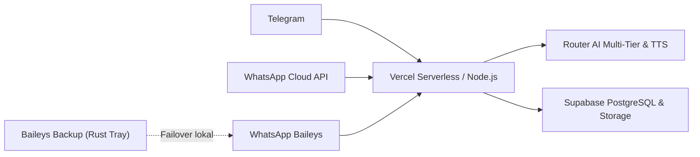

# FreeAIBot

Asisten AI multimodal untuk Telegram dan WhatsApp (Cloud API serta Baileys) berbasis TypeScript, Vercel Serverless, dan Supabase PostgreSQL, dilengkapi aplikasi tray Windows (**Baileys Backup**) untuk failover lokal.

[](LICENSE)
[](https://www.typescriptlang.org/)
[](https://nodejs.org/)
[](tools/wa-standby-watchdog)
[](https://free-chatbot-ai.vercel.app)
[](https://supabase.com)
[](https://t.me/chatkita_bot)
[](https://wa.me/6283874640066)

| Layanan | Tautan / Kontak | Keterangan |
| :--- | :--- | :--- |
| **Telegram Bot** | [@chatkita_bot](https://t.me/chatkita_bot) | Webhook Vercel Serverless (chat pribadi & grup) |
| **WhatsApp Bot** | [+62 838-7464-0066](https://wa.me/6283874640066) | WhatsApp Cloud API & Baileys (lihat [Mode Pemeliharaan](#mode-pemeliharaan-whatsapp)) |
| **Web & Dashboard** | [free-chatbot-ai.vercel.app](https://free-chatbot-ai.vercel.app) | Beranda layanan dan konsol monitoring |

---

## Fitur Utama

- **Pemrosesan Multimodal**: Membaca foto, stiker, pesan suara, serta dokumen kerja (PDF, Word, Excel, PowerPoint, TXT, CSV).
- **Voice Note & Stiker**: Mengirim balasan pesan suara natural (`Ogg/Opus`), nyanyi acapella saat diminta, serta stiker kontekstual sesuai suasana obrolan.
- **Pencarian Web**: Mengambil informasi dan berita terkini dari internet secara real-time.
- **Produktivitas & Pengingat**: Catatan, daftar tugas, pemasukan/pengeluaran, daftar belanja, ringkasan berkala, serta pengingat satu kali, berulang, dan multi-hari lewat perintah `/` atau bahasa alami.
- **Dukungan Grup Terisolasi**: Mode `/mention`, `/nimbrung`, dan `/diam` di Telegram maupun WhatsApp Baileys dengan data grup terpisah dari chat pribadi.
- **Memori, Zona Waktu & Permainan**: Mengingat konteks percakapan, preferensi personal, zona waktu per pengguna, serta permainan interaktif.
- **Failover AI Multi-Tier**: Merutekan permintaan secara otomatis melintasi 6 tier provider cloud dan node AI lokal opsional, lengkap dengan manajemen kuota harian di `/dashboard`.
- **Failover Baileys & Kontrol VPS**: Pemantauan dan pemulihan instance WhatsApp Baileys dari `/dashboard` maupun tray Windows `BaileysBackup.exe`.

---

## Arsitektur



| Komponen | Teknologi |
| :--- | :--- |
| **Runtime** | TypeScript 5.6, Node.js 22.x (ESM) |
| **Deployment** | Vercel Serverless Functions & VPS Ubuntu |
| **Transport & Suara** | `node-telegram-bot-api`, Meta Cloud API, `@whiskeysockets/baileys`, `@audio/encode-opus` |
| **Database & Storage** | Supabase PostgreSQL (RLS) & Supabase Storage |
| **Standby Watchdog** | Rust & Win32 API di [`tools/wa-standby-watchdog`](tools/wa-standby-watchdog) |

---

## Perintah Bot

Bot mendukung perintah garis miring di bawah ini maupun bahasa alami tanpa awalan `/`:

| Perintah | Fungsi |
| :--- | :--- |
| `/start`, `/help` | Memulai percakapan dan melihat daftar fitur lengkap |
| `/tanya <pertanyaan>` | Mengajukan pertanyaan langsung ke AI |
| `/reset` | Memulai sesi baru dan menghapus riwayat chat |
| `/salah <koreksi>` | Menyimpan koreksi atau preferensi personal |
| `/catat`, `/catatan`, `/cari` | Menyimpan, melihat, dan mencari catatan |
| `/tugas`, `/list` | Menambah dan melihat daftar tugas |
| `/barang` | Mencatat atau melihat daftar belanja |
| `/uang`, `/masuk`, `/rekap`, `/hapusuang` | Mencatat dan merekap pemasukan/pengeluaran |
| `/ringkasan` | Ringkasan keuangan, tugas, pengingat, dan catatan |
| `/remind <menit> <pesan>` | Menjadwalkan pengingat otomatis |
| `/mention`, `/nimbrung`, `/diam`, `/statusgrup` | Mengatur mode respons bot di grup |

---

## Struktur Proyek

```text
.
├── api/                         # Endpoint Vercel Serverless (webhook, health, stats, cron)
├── public/                      # Landing page, dashboard web, aset statis, dan stiker
├── scripts/                     # Utilitas CLI, TTS lokal, peta kode, dan pengelola watchdog
├── sql/                         # Skema utama dan migrasi PostgreSQL (Supabase)
├── src/                         # Logika inti bot, router AI, media, suara, memori, & game
├── tests/                       # Suite pengujian otomatis (node:test + tsx)
└── tools/wa-standby-watchdog/   # Aplikasi native Rust Windows Tray (Baileys Backup)
```

---

## Instalasi Lokal

### Prasyarat

- Node.js `22.x`
- Proyek Supabase aktif beserta URL dan Service Role Key
- Token bot Telegram dan/atau kredensial WhatsApp (Cloud API atau Baileys)
- Rust toolchain (opsional, hanya bila ingin membangun ulang `BaileysBackup.exe`)

### Langkah Setup

1. Klon repositori dan pasang dependensi:
   ```bash
   git clone https://github.com/Raflyf/chat-bot.git
   cd chat-bot
   npm install
   ```
2. Salin konfigurasi lingkungan dan isi kredensial di `.env`:
   ```bash
   cp .env.example .env
   ```
3. Jalankan skema SQL (`sql/schema.sql`) dan skrip migrasi berurutan di folder `sql/` melalui SQL Editor Supabase.
4. Jalankan atau uji aplikasi:
   ```bash
   npm run dev        # Bot Telegram (polling lokal)
   npm run whatsapp   # Bot WhatsApp Baileys lokal
   npm run typecheck  # Validasi tipe TypeScript
   npm test           # Suite pengujian otomatis
   npm run build      # Kompilasi ke dist/
   ```

### Baileys Backup (Windows)

Unduh installer **`BaileysBackup-setup-v1.4.0.msi`** dari [GitHub Releases (`baileys-backup-latest`)](https://github.com/Raflyf/chat-bot/releases/tag/baileys-backup-latest), atau pasang dari sumber dengan `npm run watchdog:install`. Perintah pengelola lain: `watchdog:status`, `watchdog:stop`, dan `watchdog:uninstall`.

---

## Deployment

- **Webhook Vercel**: Set seluruh variabel dari `.env.example`, lalu arahkan Telegram ke `/api/webhook` dan WhatsApp Cloud API ke `/api/whatsapp`.
- **Health & Cron**: Gunakan `GET /api/health` untuk uptime check, serta jadwalkan `/api/cron/reminders`, `/api/cron/backup`, dan `/api/cron/arsip` memakai header `Authorization: Bearer <CRON_SECRET>`.

### Mode Pemeliharaan WhatsApp

Jika pengiriman WhatsApp Cloud API ditahan Meta karena kendala *payment method* akun bisnis (error `141006`), aktifkan mode pemeliharaan sementara agar kuota AI tidak terbuang dan pengguna diarahkan ke Telegram:

```bash
WHATSAPP_MAINTENANCE_MODE=true
```

Setelah pembayaran beres, ubah kembali ke `WHATSAPP_MAINTENANCE_MODE=false` atau hapus variabel tersebut.

---

## Lisensi

Didistribusikan di bawah [MIT License](LICENSE). Hak Cipta (c) 2026 Rafly Firmansyah.
